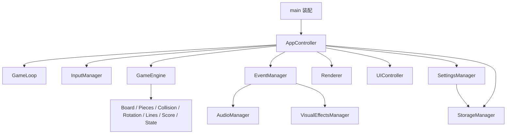

# NEON TETRIS · 软件架构

版本 0.3 · 2026-11-06（Asia/Shanghai）。第三阶段建立并获认可的目标架构；第四阶段已实现最小框架，第五阶段已实现纯规则与时间引擎；实际能力/验证分别见STAGE_04_REPORT.md与STAGE_05_REPORT.md。本文的完整契约不代表当前所有模块功能已实现。

## 一、设计取舍

原生 HTML/CSS/ES Modules、Canvas 2D、Web Audio API、localStorage；无框架、无构建步骤、无第三方运行时依赖。Node test/assert 用于规则测试，HTTP 服务用于运行。

用户列出的 16 项职责全部保留，但不强制 16 个有状态类。小算法使用纯函数模块；只有拥有资源或生命周期的边界使用工厂对象。没有 ECS、全局单例、依赖注入框架、异步消息中间件或多线程。

唯一规则状态所有者是 GameEngine。GameStateManager 是它使用的纯状态转换表，不是另一份状态仓库。AppController 是装配与生命周期协调器，不重新实现碰撞、计分或旋转。

## 二、依赖方向与数据流



箭头表示调用/导入方向。core 不导入 app、事件总线、DOM、Canvas、音频或存储；事件总线不导入任何消费者；音频与特效不互相调用。main 注入存储、随机源与平台 API，测试可替换平台边界。

正常流程：键盘/按钮 → AppController → Engine 提交动作与时间 → 原子更新规则 → 返回事务结果 → EventManager 分发整批事实 → 音频/特效消费 → 只读快照绘制。绘制不发业务事件，音效失败不回滚规则。

## 三、模块与接口

以下是接口契约，不是实现代码；参数使用普通对象，无 TypeScript 编译要求。

| 逻辑模块 | 文件 | 主要接口与职责 |
|---|---|---|
| GameEngine | src/core/game-engine.js | createEngine({rng}); start(); advanceTo(time, inputs); pause(reason); resume(); resetToReady(); getSnapshot()。变更方法返回事务数组；唯一拥有局内数据 |
| BoardManager | src/core/board.js | createBoard(); merge(board,piece); hasHiddenCells(board)。固定 22×10 数据，不存活动块 |
| PieceManager | src/core/pieces.js、bag.js | getCells(type,orientation); spawn(type,id); createBag(rng).next()/peek()。只管理模板、出生和队列 |
| CollisionManager | src/core/collision.js | canPlace(board,piece); dropDistance(board,piece)。无状态查询 |
| RotationManager | src/core/rotation.js | tryRotate(board,piece,direction) → 成功新位置与 kickIndex，或无变化结果；表见 ALGORITHMS |
| LineClearManager | src/core/lines.js | clearFullRows(board) → {board,rows,cellsBefore}。不计分、不发音效 |
| ScoreManager | src/core/score.js | lineAward(count,level); dropAward(kind,distance); levelFor(lines); gravityFor(level) |
| GameStateManager | src/core/state.js | transition(phase,command) → {phase,changed}；READY/RUNNING/PAUSED/GAME_OVER |
| InputManager | src/runtime/input.js | attach(target,submit); clear(); dispose()。输入边沿、焦点过滤、Shift 候选；不拥有游戏计时 |
| GameLoop | src/runtime/game-loop.js | start(frame); invalidate(); stop(); dispose()。全应用仅一个待执行 rAF |
| Renderer | src/render/renderer.js | resize(metrics); draw(snapshot,effectsFrame,theme); dispose()。只读、可重复绘制 |
| AudioManager | src/audio/audio-manager.js | unlockFromGesture(); handleBatch(batch); applySettings(prefs); resetSession(id); dispose() |
| VisualEffectsManager | src/effects/visual-effects.js | handleBatch(batch); sample(now); applyMode(mode); resetSession(id); clear(); dispose() |
| SettingsManager | src/data/settings.js | load(); get(); update(patch); subscribe(fn)→unsubscribe; dispose()。六项偏好及系统减少动态监听 |
| StorageManager | src/data/storage.js | readPreferences(); writePreferences(value); readBest(); writeBest(score) → 明确成功/失败结果，不抛给游戏循环 |
| EventManager | src/runtime/events.js | subscribeBatch(fn)→unsubscribe; publishBatch(batch); clear()。同步、有序、批量通知 |
| AppController（装配补充） | src/app.js | start/restart/pause/resume/openSettings/closeSettings/returnToTitle/dispose；协调资源和来源时间转换 |
| UIController（界面补充） | src/ui/ui-controller.js | bind(commands)→dispose; render(viewModel); focus(target); getOverlayState()；只管理 DOM、弹层与焦点 |

clearFullRows、merge 返回新棋盘；tryRotate 不修改输入；模板不允许调用方修改。小棋盘按 revision 复制只读快照足够，不增加增量状态框架。

## 四、数据所有权与快照

| 数据 | 唯一所有者 | 对外可见范围 |
|---|---|---|
| phase、board、active、queue、hold、canHold、score、lines、level | Engine | 只读快照；queue 仅暴露 next 类型，不泄露可变数组 |
| logicalTime、重力/锁定/DAS/ARR 计时、held 状态、pieceId | Engine | 时间与 pieceId 可供事件和诊断；定时器不由 UI 修改 |
| sessionId、全局 eventSeq/transactionId、平台时间映射 | AppController | 事件信封；sessionId 单调递增，不跨局复用 |
| 设置、系统减少偏好与有效模式 | SettingsManager | 只读订阅，字段更改后立即通知 |
| bestScore、bestAtStart、保存状态 | AppController | 合并到 HUD/结束页 viewModel，不写回 Engine 分数 |
| overlay、returnTarget、焦点恢复目标 | UIController | 界面状态，AppController只通过查询接口检查弹层，不另存一份 |
| AudioContext、音符节点、调度计时器 | AudioManager | 状态诊断，不暴露节点给 Engine |
| 特效条目、粒子、动画句柄、亮度峰值窗口 | VisualEffectsManager | 只读 effectsFrame，不修改棋盘 |

Snapshot = {revision,logicalTime,phase,board,active,ghost,next,hold,canHold,score,lines,level}。active={id,type,orientation,x,y}，ghost={x,y,distance} 或 null。board 为不共享写引用的行数组。READY/结束可保留最终快照，但 GAME_OVER 不绘制可操作活动块。

## 五、命令、时间与事务

输入信号：HORIZONTAL_DOWN/UP(direction)、SOFT_DOWN/UP、ROTATE(direction)、HARD_DROP、HOLD；状态命令 START/PAUSE/RESUME/RESTART/RETURN_READY 由 AppController 单独调度。方向为 CW/CCW 或 -1/+1，不携带键码进入 core。

InputManager 采集 {at,order,kind,payload}，at 来自同一 performance.now 单调时间域；不使用 Date.now。DOM event.timeStamp 不直接混用，重复 keydown 忽略。Engine 内负责 150/45 ms 横移与 35 ms 软降重复，使规则不依赖事件频率或绘制帧。

AppController 将平台时间映射为仅 RUNNING 推进的逻辑时间。pause 前先结算到暂停时间，resume 重建映射、清除输入、冻结时长不进入逻辑时间。UI 输入进入一个有界时间序列，按 at/order 排序，不能按渲染帧丢弃后续动作；上限 512 个，溢出则明确暂停并清空输入，不静默丢关键按键。

advanceTo：按输入时间和引擎到期时间逐项推进到目标时间。相同逻辑时间戳先捕获旧 pieceId；锁定到期先于输入，其次按输入 order（包括暂停控制项），最后处理到期重复/重力（垂直只有一个来源）。DOWN/UP 始终更新 held 和未来重复截止，不能因换块丢弃松键；旧代际只抑制同刻的即时位移/旋转/Hold/硬降。新 DOWN 同刻遇换块可安排未来重复但不立即移动新块；之后时间戳正常作用新块。一个 due 必须推进截止时间或改变状态，避免零时长死循环。

PAUSE 作为有时间戳的控制项交给 advanceTo，在到期锁定之后、同刻重复/重力之前生效；pause(reason) 只处理此时当前逻辑时间的状态变更。不能先推进该时刻全部重复再暂停。START/RESTART/RESUME 不推进冻结时间。

每个输入/到期规则动作是一个事务，推进可返回多个按时间排序的事务；同一事务先提交完整状态再通知。普通渲染帧或失败动作返回空事件，不因绘制产生 MOVE。超长主线程停顿 >250 ms 时在处理积压前自动暂停，保留最后已提交规则时间、丢弃未提交输入，避免突然追赶；正常帧间隔不 clamp、不丢逻辑时间。此异常策略需单独测试，不把暂停后的轨迹与未停顿轨迹宣称相同。

## 六、事件接口与精确数量

Engine 返回 {events,summary,revision}，不直接调用 EventManager。AppController 添加信封并分发：

Event = {sessionId,transactionId,seq,source,type,logicalTime,pieceId,data}；Batch = {sessionId,transactionId,events,summary}。seq 全应用递增，source=CORE/UI/SETTINGS；无关联方块时pieceId=null；UI 事件 logicalTime 为最后规则时间。消费者在收到批次时用平台/音频当前时间启动表现，不能把 logicalTime 当 AudioContext.currentTime。

summary={cause,linesCleared,levelBefore,levelAfter,scoreDelta,hardDropDistance,ended}，包含该事务完整结算结果，解决 LOCK 回调时还不知道后续消行的问题。没有散落的“先播放固定音再想办法撤销”。

| 事件 | 条件与数量 | data 关键字段 |
|---|---|---|
| GAME_START | 每次成功建立新局一次 | level、seedLabel（可选诊断，不承诺产品种子界面） |
| MOVE | 每次成功横移一次，失败零次 | from、to、direction |
| ROTATE | 每次成功且占格/朝向有效变化一次；O 零次 | from、to、direction、kickIndex |
| SOFT_DROP | W 驱动每成功一格一次 | distance=1、scoreDelta=1 |
| HARD_DROP | 每次有效按压一次，距离零也一次 | from、to、distance、scoreDelta=2d |
| LOCK | 每个固定的方块恰好一次 | cells、cause=GRAVITY/SOFT/HARD；非硬降时记录最近一次导致当前接触的垂直来源，出生即受支撑记 GRAVITY，不按锁定到期时 W 是否按住猜测 |
| LINE_CLEAR | 一次锁定消 1～4 行时一次，不逐行发 | rows、count、cellsBefore、scoreDelta、levelBefore |
| LEVEL_UP | 一次结算跨级时一次 | from、to |
| HOLD | 每次合法暂存一次，同轮拒绝零次 | stored、received、wasEmpty |
| SCORE_CHANGED | 事务总分确有变化时最多一次 | score、delta、lines、level |
| PAUSE | RUNNING→PAUSED 一次 | reason=USER/SETTINGS/FOCUS/HIDDEN/STALL/OVERFLOW |
| RESUME | PAUSED→RUNNING 一次 | reason=USER |
| GAME_OVER | RUNNING→GAME_OVER 一次 | reason=HIDDEN_OCCUPIED/SPAWN_BLOCKED/HOLD_BLOCKED、最终统计 |
| UI_CHANGED | 实际界面变化一次，来源 UI | from、to，不由渲染发出 |
| SETTINGS_CHANGED | 有效设置变化一次，来源 SETTINGS | changedFields、effectiveMode |

重力自然移动不发软降音事件，画面通过 revision 改变刷新。硬降事务有 HARD_DROP→LOCK→可选 LINE_CLEAR→可选 LEVEL_UP→可选 SCORE_CHANGED→可选 GAME_OVER；不额外发 MOVE/SOFT_DROP。无行锁定没有 LINE_CLEAR；最高分由 SCORE_CHANGED 后快照更新，不能再触发一次得分。空 Hold 消费 Next，非空交换不消费；若换出出生受阻，HOLD 后接 GAME_OVER，不接 LOCK。

## 七、事件分发、去重和清理

1. AppController 是 publishBatch 唯一入口；核心返回的事务仅消费一次，不把上帧事务缓存到快照。每帧可以画多次而不再分发。
2. 订阅用 Set，同一函数不重复注册；subscribeBatch 返回可重复调用的取消函数。移除监听不会移除其他函数。
3. publishBatch 遍历订阅快照，调用前检查仍在 Set 中。订阅期间新增者从下一批生效。消费者异常交给 onError 记录并继续其他消费者，不吞掉诊断，也不回滚状态。
4. 通知期间禁止递归 publish 和直接改 Engine；新的 UI 命令进入下一调度轮。事件是已经发生的事实，不是任意模块发布指令的总线。
5. 音频/特效各只订阅一次；处理端记录当前 sessionId 与 lastSeq，忽略旧局或已处理 seq。批内按序消费后更新游标，不能为每个事件永久存 Set。
6. AppController 对新局先隔离旧 session，再清输入/旧事件、重置音画、重置 Engine，最后分发 GAME_START。消费者不能在新局复位游标后接受旧 Promise 回调。

## 八、状态机与 UI 边界

唯一名称 READY、RUNNING、PAUSED、GAME_OVER；旧文档 PLAYING 统一迁移为 RUNNING，不保留同义枚举。

| 当前 | 命令/条件 | 结果 |
|---|---|---|
| READY | START | RUNNING，新局；GAME_START |
| RUNNING | PAUSE/失焦/隐藏/设置/停顿 | PAUSED，冻结计时、清 held；一次 PAUSE |
| PAUSED | 明确 RESUME 且无弹层且页面可见/获焦 | RUNNING；一次 RESUME |
| RUNNING | 顶部失败 | GAME_OVER；一次 GAME_OVER |
| RUNNING/PAUSED | 局内重开 | 先暂停，显示确认；取消回 PAUSED；确认才新局 |
| GAME_OVER | RESTART | 新 session 的 RUNNING；GAME_START，无额外 RESUME |
| GAME_OVER | RETURN_READY | READY，清旧局资源；UI_CHANGED |
| 任意 | 重复/非法命令 | 不变，无重复状态事件 |

设置层不是第五个规则状态。RUNNING 打开设置先 PAUSE(SETTINGS)，关闭只回 PAUSED；READY/GAME_OVER 设置返回原页。Esc 先交给最顶弹层，只执行关闭/取消；没有弹层时 P/Esc 可在暂停页继续按钮焦点下继续。

焦点离开棋盘先暂停；pointerdown 记录底栏按钮原始目标，focusout 不把本次暂停 click 变成继续。按钮空间/回车保留原生行为。C 按下 Hold，Shift 独立释放才 Hold；任何组合/焦点变化取消 Shift 候选。

## 九、音频与动画资源生命周期

AudioManager 拥有至多一个 AudioContext：在真实开始/继续/启用声音的同步用户处理函数内调用 unlockFromGesture，不能先等待别的 Promise 再解锁。resume 是异步操作，需捕获失败并验证 session/version；详见 [MDN AudioContext.resume](https://developer.mozilla.org/en-US/docs/Web/API/AudioContext/resume)。游戏无需等待音频成功。

资源分为 app 级（Context、musicGain、sfxGain、masterGain、一个订阅）和 session 级（音符节点、音乐调度器、延迟奖励任务、fade 自动化）。换局/销毁递增 sessionVersion，音乐重排递增 musicVersion，预听取消递增 previewVersion，关闭音效只取消 sfx 资源。回调检查局次及所属局部版本，不能因停止预听而失效整曲。解锁完成还核对当前 phase、可见性、音乐开关，暂停后不启动整曲。开始顺序：先同步分配新 session/reset 各消费者，再在同一次用户事件栈内 unlock，最后提交 GAME_START；不等待解锁 Promise 才开始游戏。

- 音乐用 25 ms 检查、100 ms 前瞻和 AudioContext 时间，只有一个调度器；16 小节谱放在 music-score.js。pause 保存乐曲偏移、停排程、取消未来节点，80 ms 释放；保留独立 sfx 总线播放暂停提示，不因暂停先 suspend 整个 Context。
- resume 从保存偏移重新建立基准，120 ms 淡入；game over 600 ms 淡出，sfx 结束提示独立；立即重开取消旧淡出自动化、停止节点并重新从曲首开始。
- 声音源入注册表，onended 断开并删除；音效声部上限 8，普通操作按规范限频；同事务消行优先级依据 summary 决定，延迟升级音带 sessionVersion 和独立 sfx 取消标记。
- 设置预听单独记录句柄，最多 500 ms；返回/暂停变化/关闭开关/重开都可取消；音乐预听不推进暂停乐曲位置。两总线开关互不影响。
- dispose 幂等：停调度器和延迟任务、停止/断开所有节点、取消订阅、close Context；正常重开不反复关闭重建 Context。

VisualEffectsManager 使用公共 GameLoop 的表现时间，不创建自己的 rAF。条目为 {id,sessionId,type,start,duration,payload}，到期删除；总条目上限 16、可选粒子总数 32，生命周期上限见专项规范。样本是只读绘制数据；局部消行快照不引用可变棋盘。

降低模式或关闭设置后立即清除不合规特效、取消 DOM Animation 句柄，不只隐藏元素。关闭模式不再采样装饰动画；保留必要规则绘制和静态反馈。暂停取消短效而不补播；resetSession(id) 换局时更新接收局次、游标并清资源，同局 clear() 不重置 lastSeq。重开/返回标题/销毁清空全部条目和句柄。效果层统一执行任意滚动 1 秒最多两次亮度峰值，四消不叠单/多行光效。

## 十、循环、设置与存储

GameLoop.start 幂等：已有待执行 rAF 则不再申请；回调先清当前句柄，处理命令/推进/分发，然后采样效果、绘制快照，再按需要申请下一帧。RUNNING 连续更新；静态 READY/PAUSED/结束页在无装饰动画时只由 invalidate 请求单帧。stop 取消待执行句柄，dispose 后不得复活。

隐藏页面立即暂停并停止帧，回前台 invalidate 绘制但不恢复游戏。rAF 后台可能停止，不能靠回调自动恢复时间，见 [MDN requestAnimationFrame](https://developer.mozilla.org/en-US/docs/Web/API/Window/requestAnimationFrame)。

SettingsManager 只存六项偏好，effectiveMode 派生，不写成第二份持久化值；null 减少偏好跟随系统，布尔显式覆盖。load 时不预听。订阅通知后各模块 applySettings，不让音频反向修改偏好。

StorageManager 注入 storage 对象；访问本身、解析和写入都捕获错误。键、schemaVersion=1、数值校验见 GAME_RULES。最高分写入由事务后 AppController 执行，不由 Renderer 执行。滑块保存可合并约 150 ms，change/关闭设置/dispose 时尝试最终写入；失败继续内存值并展示未保存，不无限重试。

## 十一、计划目录（本阶段不创建）

```text
index.html
package.json                 # type=module，最小 dev/test 脚本
styles/{tokens,layout,theme}.css
src/main.js
src/app.js
src/core/{game-engine,board,pieces,bag,collision,rotation,lines,score,state,rules}.js
src/runtime/{input,game-loop,events}.js
src/render/renderer.js
src/ui/ui-controller.js
src/audio/{audio-manager,music-score,sound-presets}.js
src/effects/visual-effects.js
src/data/{settings,storage}.js
assets/{fonts,textures,audio}/  # 仅有实际素材时创建；首版可为空且不创建
scripts/serve.mjs
tests/unit/{board,pieces,bag,collision,rotation,lines,score,engine,input,state,events,settings,storage}.test.js
tests/integration/{timing,transactions,lifecycle,audio-feedback,visual-feedback}.test.js
tests/fixtures/               # 固定棋盘、随机源、虚拟时钟和事件捕获
tests/browser/               # 实际引入自动化后才添加；否则人工步骤写 docs
docs/                        # 现有文档及新增架构、算法、任务、验证计划
```

音乐谱与音效参数是源码数据，归 src/audio；外部静态素材才归 assets，必须记录来源许可。文件不要求提前全部创建，函数短小的模块可保持一个文件，不为模块名制造空类。

## 十二、第五阶段实现补充

Engine已实现dispatch即时独立事务和advanceTo时间化批次。已结算时间点不再接受追加输入，晚到同刻输入在批次执行前拒绝，避免不同调用拆分改变重力顺序；输入适配器后续须将真正晚到的输入安排到新逻辑时刻。初始夹具只用于确定性测试，不向UI开放。事件仍由App补全局信封并发布，核心不调用事件总线或视听模块。第五阶段尚未完成浏览器输入/持续循环/活动块绘制接线；第六阶段已完成绘制，输入/持续循环继续待办。

## 十三、第六阶段实际表现接口

- createRenderer(canvas,{nextCanvas,holdCanvas})返回draw(snapshot)/dispose；尺寸与DPR在draw内按需更新。目标表中resize与effectsFrame/theme仍是后续完整特效接口，没有虚构现存方法。render-model是纯数据映射，piece-painter是Canvas格子材质。
- createUIController(document,{effects})负责状态、HUD与原生dialog；showLevelUp/clearTransientFeedback管理400ms提示，App开始新session/返回标题时清理。
- Effects新增transition(target,kind)，拥有有上限的WAAPI句柄，取消/完成均移除；applyMode/resetSession/clear/dispose清句柄，不创建rAF。sample当前无粒子条目，只报告mode和activeAnimations；完整7类局内反馈尚未实现。
- src/dev/visual-review.js是独立验收入口，不导入GameEngine，不持久化；重用同一Renderer/UI，合成快照只验证表现，不检验真实App状态闭环。

## 十四、方案A返工后的表现资源

Effects构造参数新增targets={layer,screen}和onLineClear(count)，App只装配DOM目标，核心事件不变。lineClear读取rows/cellsBefore复制为最多4行旧格残影，150/200ms后移除；新消行先取消旧残影避免叠亮。全局Map最多16句柄，完成/取消释放对应节点；旧Promise回调按动画身份查找，不影响新句柄。无新增rAF/逐帧JS特效循环。

transition区分普通维护面板的clip显现、digit数值确认、80ms impact、420ms end；title不动画。结束/暂停批次抑制同批其他装饰反馈，消行优先于硬降。减少模式跳过消行残影与冲击，关闭模式不创建动画；文本提示始终可用。UI只在数值实际变化时请求digit，resize/重复render不重播。

视觉夹具导入clearFullRows纯函数生成合法前后棋盘与cellsBefore，280ms预看timer由reset/phase/pagehide清理；设置/帮助/重开先暂停。该timer不在生产App或规则循环中，不代表游戏锁定延迟。

## 十五、第七阶段实际运行接口（2026-11-07）

本节为当前实现；上方计划目录/旧“待接线”叙述保留历史。

- createInputManager({target,canPlay,canToggle,submit,togglePause})构造时注册keydown/up，返回clear/getStatus/dispose。持有物理边沿与Shift候选，不创建重复键定时器。
- createGameLoop({requestFrame,cancelFrame,onFrame,isRunning})返回start/invalidate/stop/getStatus/dispose，单pending handle；start幂等，静态按需，dispose不可复活。
- createSessionController({engine,publish,resetResources,invalidate,clearInput,now})集中平台/逻辑映射及有界queue，返回start/submit/advance/pause/resume/restart/returnToTitle/getSnapshot/getStatus/dispose。暂停在advanceTo内插时间化PAUSE；STALL/OVERFLOW不追赶。
- createApp(options)可注入平台及消费者，实际组装上述三者、单事件订阅、存储和表现。仅getStatus/getSnapshot/dispose对外；生产main未向window暴露作弊或夹具接口。UI只读渲染与动作绑定。
- AudioManager已实现谱与15音，新增preview/cancelPreview和状态诊断；一个音乐setTimeout（25ms/100ms前瞻），音效错峰使用WebAudio起始时间，不新增延迟JS定时器。音乐/音效双总线直接连接destination，采用低峰值包络；目标架构里的masterGain未增加，输出峰值仍待真实信号检查。预听节点标记所属通道、约300ms，并在对应偏好变化/失焦/关闭/换局清理。resetSession进入READY，clear旧节点/调度/版本；dispose幂等且close拒绝不传播。
- Effects继续有限WAAPI，不创建rAF；分级1/2/3/4消和四消彩带参数见音画最新节。UI拥有唯一400ms标签定时器，换局/状态清理。
- best/bestAtStart/bestSaved归App；UI.render第四参数传状态补充，未把best写回Engine分数。设置仍即时容错写入，未额外引入保存防抖计时器。

116项自动化、44份语法通过；整合验收页使用真实App和固定初局/内存存储，生产入口不加载。实际设备听音/持续浏览器/FPS仍待完成，详见STAGE_07_REPORT。


## 2026-11-07试玩反馈覆盖

新增core/intensity.js共享纯时间曲线，score.gravityFor(level,time=0)、Engine自然重力排程读logicalTime；App每帧设置audio.setIntensity，重复同档无副作用。Effects回调onLineClear(count,data)透传奖励；Map上限32、四消最多21临时节点，无第二rAF或timer。当前旧16上限/无图片/仅等级速度描述由本节覆盖。
